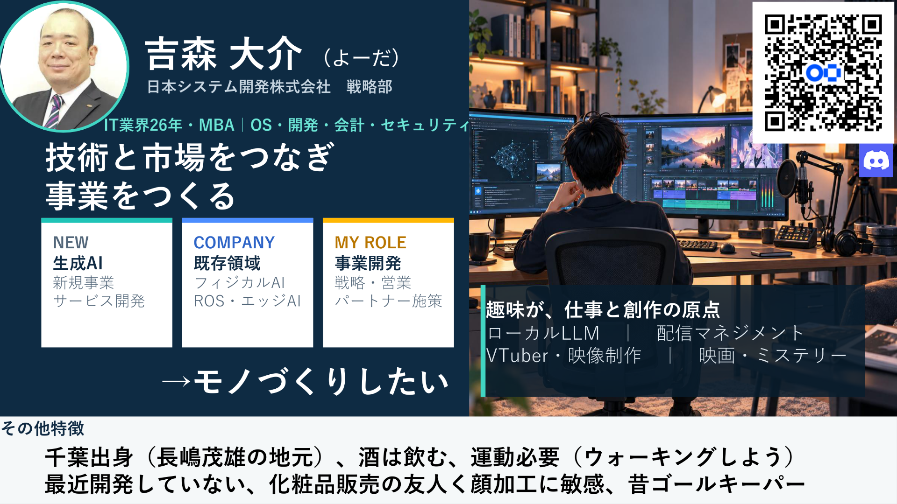
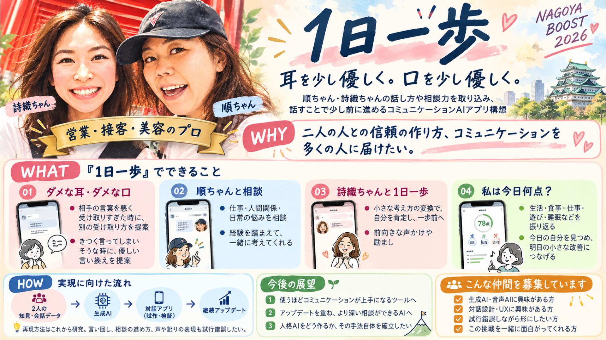
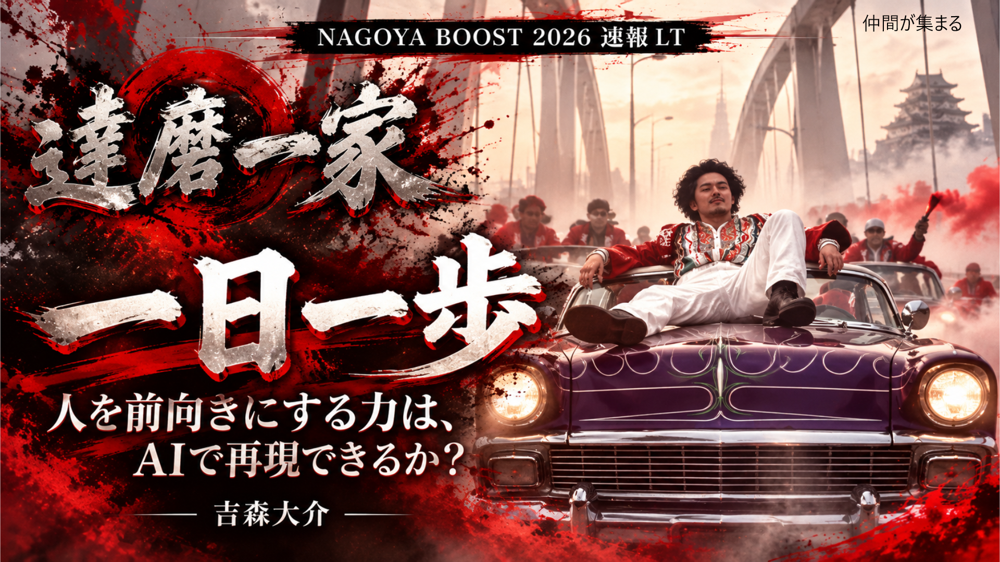

# 達磨一家｜一日一歩

耳を少し優しく。口を少し優しく。

NAGOYA BOOST 2026で取り組むコミュニケーションAI「一日一歩」の紹介です。

## プレゼンテーション

## 現在できているモジュール

2026年10月23日時点。現在は、対話データを集めて文字起こしするための基盤を開発しています。

| モジュール | できること | 現在の状態 |
| --- | --- | --- |
| 通話・録音PWA「一歩の記録」 | ブラウザーでの二者音声通話、招待リンクによる参加 | 実装済み。iPhone実機・別ネットワークでの一連の動作確認が残っています |
| 同意管理・話者別録音 | 双方の同意を確認して録音し、二人分の音声を別々に保存 | 実装済み。Chromeでの検証記録あり |
| 端末保存・Google Drive連携 | 録音を端末に保存し、チームの保存先へ自動送信。失敗時の再送にも対応 | 実装済み。本番API経由の保存・再取得・重複防止を合成音声で確認済み |
| 連絡先交換・端末認証・着信 | 連絡先を交換し、登録した相手への発信、複数端末の登録・解除 | 実装済み。iPhoneの通知・背景着信など、本番有効化前の実機確認が残っています |
| Windows用ローカル文字起こし | 音声・動画を読み込み、日本語の文字起こしと発言時刻を出力 | 開発版あり。RTX 2070（VRAM 8GB）で音声認識・時刻照合のGPU動作を短い実録音で確認済み |
| 話者ラベル・結果の書き出し | 二人の話者ラベル、名前の割り当て、TXT・Markdown・CSV・SRT・VTT・JSON出力 | 実装済み。標準の話者分離はCPUで処理し、誤認識・話者の取り違えは人が確認します |

録音アプリと文字起こしツールは分かれています。録音を保存した後、担当者が対象を選んで文字起こしします。相談AI本体と、校正したデータを相談知識として利用する仕組みは、今後の設計・開発対象です。

## 今後の設計スケジュール

今後2ヶ月以内に音声入力データを回収し、並行して相談アーキテクチャを構築します。3ヶ月目はアプリを洗練し、その頃からAI人格の紹介・宣伝を始める計画です。

| 時期 | 取り組むこと | 目指す状態 |
| --- | --- | --- |
| 今後2ヶ月以内 | 音声入力データの回収 | 通話・録音・保存の基盤を使って、本人の同意を得た音声データを収集・整理する |
| データ回収と並行 | 相談アーキテクチャの構築 | 相談の進め方、AI人格の表現、知識の参照方法を設計し、試作につなげる |
| 3ヶ月目 | アプリの洗練 | 試用結果をもとに、使いやすさや相談体験・応答品質を改善する |
| 3ヶ月目頃から | AI人格の紹介・宣伝 | どんな人格で、どんな相談体験を目指すのかを発信する |

ローカルGPUでの文字起こしと人手校正の運用も整え、回収したデータを相談アーキテクチャの検討に活かします。担当・作業日程は、コミュニケーションリーダーを中心に各メンバーと調整します。

## 開発環境

共通環境：VSCode、Github

チーム内LLM：

- ChatGPT Code Plus、Business
- ChatGPT Code Plus
- Claude Code 課金

モジュール別の作業環境です。

| モジュール | 環境・技術 |
| --- | --- |
| 通話・録音アプリの開発 | Windows、VS Code、Node.js 22.12以上、React、TypeScript、Vite |
| 通話・端末内保存 | PWA、WebRTC、MediaRecorder、IndexedDB |
| Web配信・通話の接続管理 | Vercel、Cloudflare Workers / Durable Objects、Cloudflare TURN |
| 録音の保存先 | チームで管理するGoogle Drive |
| ローカル文字起こし | Windows 11（64bit）、Python 3.10推奨、WhisperX / faster-whisper、FFmpeg、sherpa-onnx |
| GPU処理 | NVIDIA CUDA対応環境。確認済み構成はRTX 2070・VRAM 8GB。必要なメモリ量はモデル・設定で変わります |

文字起こしはCPUでも実行できます。今回募集するGPU担当者には、ローカルGPUを使った処理と、結果の確認・校正につながる運用を一緒に整えていただきたいと考えています。

## 体制　（8名）
### (内部)
 - リーダー：　吉森大介　（企画、工程管理）
 - メンバー：　宮家綾汰　データ取り込み理論検討
 - メンバー：　松本基義　（役割未定）
### (外部)
 - 開発サポート：　稲垣
 - 開発アドバイザー：　杉浦
 - ユーザー企業：　順
 - ユーザー企業：　詩織
 - ユーザー企業事務：　さき
### (ステークホルダー）
 - 日本システム開発　投資相談
 - 吉森大介　自己投資
 - 稲垣　投資家
 - 日本システム開発　必要に応じて開発リソース相談（100名以上）
 - コスメMitsuhashi　ユーザー企業
 - ユーザー　エステ・メイク顧客　1000名～

## 採用基準

積極採用はしていません。おおよそ追加1名まで。

研究稼働が足りないかもしれないですので、ある程度、作業できる方。
次の役割の担い手次第。以下の役割をこなせる方だと助かります。

### 1. コミュニケーションリーダー

吉森大介から構想をヒアリングし、各メンバーに伝える役割です。メンバーとのスケジュール調整・管理もお願いします。

- 構想や意図をヒアリングし、メンバーに伝わる形に整理・共有する
- 各メンバーとのスケジュールを調整・管理する
- MUST：　コミュニケーション能力高く、人との間に立って調整できる方

### 2. ローカルGPUでの文字起こしを担当できる方
- 文字おこし後のデータ修正
- MUST：　RTX2070・VRAM 8GB以上

ローカルのGPUリソースを使って、音声データの文字起こしを行える方を募集しています。

### 3. デザイナー

### 4. コーダー・テスター
　プログラムのコーディングルールを決めて、品質担保してくださる方
